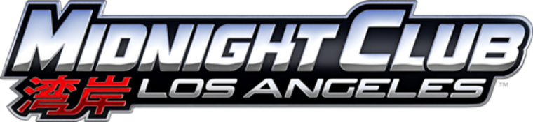

<div align=center>



</div>
<h1 align=center>Midnight Club Los Angeles - Native NX Port</h1>

Native port of the 2008's fourth installment on the Midnight Club series: **Midnight Club Los Angeles from Xbox 360**.

There is no emulation here. None, zilch, nada. It is pure PowerPC code translated to C++ using [ReXGlue](https://github.com/rexglue/rexglue-sdk), thanks to the efforts of the devs of [MCLA-Recomp project](https://github.com/holdmysocks/mcla-recomp). 
The game the runs directly with shaders compiled specifically for the Switch, with a launcher compiled to run with the recompiled code. It uses Deko3D as its 3D renderer and targets 30 FPS. Mild CPU overclock might be needed to reach such target. Everything will be explained in this document.

> [!NOTE]
> You need your own Xbox 360 copy of the game (`.iso`) to be able to play this port. This port does not come with copyrighted material. I don't want John Rockstar at my doorstep, y'know.

## How to install

1: Download the Switch executables from [releases](https://github.com/Wivi2013/mcla-nx/releases) and extract it.
2: Send the "switch" folder inside the extracted .rar to the root of the Switch SD card.
3: Visit [MCLA-Recomp project](https://github.com/holdmysocks/mcla-recomp) and follow their instructions to recompile your .iso.
4: Locate the game files and copy all of them to switch/MCLA-NX/game
5: Open Sphaira and create a forwarder with 39 bit address space and 4 CPUs.
6: Open game and play (optional)

Your folder should look like this
```text
/switch/MCLA-NX/
  nfsmw-nx.nro
  mcla_graphics.toml        (graphical settings)
  shaders-c064/             (the game shaders)
  game/                     (the game itself)
```

## Resolution

The resolution is automatic by default (`nfsmw_resolucion_interna = "automatico"`): **1280x720** in handheld mode and
**1920x1080** docked. It's chosen when the game starts: if you dock or undock the console while playing, the game keeps
the resolution, scaled to the screen until you restart it. ReverseNX-RT's Fake Docked and Fake Handheld count as well:
choose the mode in its overlay and restart the game. The choice is kept until you restart the console.

To use one resolution in both modes, set it in `nfsmw.toml` (or in the Debug Menu, category **Graficos**, then
**Save to config**) and restart the game:

- `1280x720`: the resolution of the Xbox 360 version. Docked, it can give a higher frame rate than `1920x1080`, which
  has 2.25 times the pixels while the docked GPU clock is only 1.67 times the handheld one.
- `1920x1080`: sharper, at a high GPU cost, above all in handheld mode.
- `1024x576`, `640x360` and `640x480` only shrink the image after it is drawn at 1280x720, so they do not raise the
  frame rate.

> [!NOTE]
> If you're having bad performance on Docked and don't want to apply a higher OC + you want more FPS, set the resolution to 1280x720.

## Performance

In handheld mode the port asks the system for its official 460.8 MHz GPU mode, a standard performance configuration
of the console and not an overclock. Races average 32 to 35 FPS; the heaviest area measured, the exit of Heritage
Heights, runs at 21-22 FPS for about 20 seconds.

How it went from a few frames per second to this is explained step by step in
[docs/performance-history.md](docs/performance-history.md).

## Overclocking

Due to the nature of the RAGE engine and my inexperience with coding, for now you need to overclock your console.
These are the ""comfortable"" settings that currently (pre-release) you can safely run in any console and get a taste of the current progress.

<div align="center">

| Mode | CPU | GPU | Memory |
| --- | --- | --- | --- |
| Handheld | 1658 MHz | 460.8 MHz | 1331.2 MHz |
| Docked | 1963 MHz | 768 MHz | 1600 MHz |

</div>

> [!CAUTION]
> Overclocking is inherently risky so tread carefully. V1 consoles are usually very fickle and have lower limits.
> V2/Lite and OLED consoles can be pushed further so these are recommended if you want an almost lag-free experience
> meaning 30 FPS with some places going under that, at around 2397 MHz CPU clock, 768 MHz GPU clock and 2133 MHz RAM clock.
> Make sure to follow the guides below.

These guides explain how to do it:

- **[How to get 60 FPS](https://rentry.org/howtoget60fps)**
- **[Mariko guide](https://rentry.co/mariko)**
- **[Erista guide](https://rentry.co/erista)**
- **[How to test stability](https://rentry.co/howtoteststability)**


## Legal

No affiliation with Take-Two or Rockstar Games and Nintendo. "Midnight Club" and "Midnight Club Los Angeles" are trademarks of Take Two Interactive.
This repository contains no assets or program code from the original game. Users must provide their own legally obtained copy. 
Running homebrew requires custom firmware, which is against Nintendo's TOS. Doing so risks a ban on your console. You have been warned.

Source code will be released when I get the time to get everything sorted.
