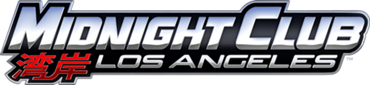

<div align=center>



</div>
<h1 align=center>Midnight Club Los Angeles - Native NX Port</h1>

Native port of the 2008's fourth installment on the Midnight Club series: **Midnight Club Los Angeles from Xbox 360**.

There is no emulation here. None, zilch, nada. It is pure PowerPC code translated to C++ using [ReXGlue](https://github.com/rexglue/rexglue-sdk), thanks to the efforts of the devs of [MCLA-Recomp project](https://github.com/RenanQueiroz/mcla-recomp). 
The game the runs directly with shaders compiled specifically for the Switch, with a launcher compiled to run with the recompiled code. It uses Deko3D as its 3D renderer and targets 30 FPS. Mild CPU overclock might be needed to reach such target. Everything will be explained in this document.

> [!NOTE]
> You need your own Xbox 360 copy of the game (`.iso`) to be able to play this port. This port does not come with copyrighted material. I don't want John Rockstar at my doorstep, y'know.

## How to install

> [!NOTE]
> The only version supported is the Midnight Club: Los Angeles - Complete Edition for the EUR and USA region in .iso format.

1: Open the [installer page](https://wivi2013.github.io/mcla-nx/) made specifically for this port.

2: Press `Choose disc image` and navigate to where your legal dump of Midnight Club: Los Angeles - Complete Edition is located.

3: Press `Save as ZIP` then let the the browser do its thing. It will then download the recompiled game with everything you need for the port to run on your Switch.

4: Extract the contents of the .zip and move them to the root of your Switch's SD card.

Your game folder should look like this
```text
/switch/MCLA-NX/
  game/                         (the game itself)
  shaders-c064/              
      deko-host/                (Deko3D shaders compiled for the GM20B/B01)
      shader-cache/             (shader cache that grows the more you play)
      deko3d_glsl.bin           (pre-decompiled shading data)
      mcla_shader_metadata.bin  (shader lookout map)
  mcla-nx.nro                   (the executable)
  mcla.toml                     (game settings/debug options)
```

## Performance

You can expect around 20~ FPS on stock handheld mode at stock clock: `1020/384/1331`. This game is very CPU intensive because of the huge car density and asset loading. On docked clocks (`1785/768/1600`) performance is overall tolerable. As for now (Beta 1 c299) performance is decent enough to enjoy the game at recommended overclock settings.

You can additionally tweak the performance and display settings to suit your preferences.

These settings are found inside the options menu ingame by pressing the "plus" button and the navigating to the options slot by pressing "DPAD Right" or "R" two times. There you can find the Display and Performance options.

```text
Display>
  <Handheld Resolution - Range: 360p to 1080p.        (Sets the resolution when playing in handheld mode)
  <Docked Resolution - Range: 360p to 1080p.          (Sets the resolution when playing in docked mode)
  <PD Charger Resolution* - Range: 360p to 1080p.      (Sets the resolution when playing plugged in with OEM charger)
  <Anisotropic filtering - Range: GAME to 16x.        (Sets the texturing filtering passes. GAME = How 360 done)
  <UI AT 720P - Range: Yes to no.                     (Enables if the UI stays sharp at resolutions lower than 720p)
Performance>
  <FPS Target - Range: UNCAPPED to 120.               (Sets framerate target for Vsync and game engine)
  <VSync - Range: Yes to no.                          (Enables vertical sync to eliminate tearing)
  <Motion Blue - Range: Yes to no.                    (Enables motion blur effects)
  <Upscaler - Range: Bilinear or FSR1.                (Changes between upscalers)
  <FSR Softness - Range: 0.00 to 2.00.                (Modifies the sharpness that FSR provides)
  <Single tile rendering - Range: Yes to no.          (Tells whether the GPU renders frames in single or multiple pieces)
  <City detail distance - Range: 0.00 to 1.00.        (Sets the relative distance where details render fully)
  <Traffic detail distance - Range: 0.00 to 1.00.     (Sets the relative distance where traffic changes the LOD model)
  <Traffic distance - Range: 250 to 400.              (Sets minimum distance for traffic to spawn)
  <Traffic density - Range: 0.00 to 1.00.             (Controls how many cars % spawn)
  <Pedestrians - Range: 0.00 to 1.00.                 (Controls pedestrian spawn density)
  <Parked cars - Range: 0.00 to 1.00.                 (Controls density of parked cars)
  <Simple car shadows - Range: Yes to no.             (Enables simple car shadows)
  <Distant trees - Range: Yes to no.                  (Enables rendering of low LOD models of trees over long distances)
  <Fullscreen blur - Range: Yes to no.                (Enables blur over scenery)
  <Anti aliasing - Range: Yes to no.                  (Enables dynamic MSAA to smooth out edges)
```
- Settings marked with `(Next start)` or `(Next load)` require a game re-start to fully apply.
- *The PD charger profile is ONLY loaded if you have a PD 15V or OEM charger connected to your device. It will not work on chargers that only output 5V. The Switch does not accept 9 or 12 V.

## Overclocking

Due to the nature of the RAGE engine, you need to overclock your console.

</div>

> [!CAUTION]
> Overclocking is inherently risky so tread carefully. V1 consoles are usually very limited by nature of being older units.
> V2/Lite and OLED consoles can be pushed further because of the updated SOC they have (Tegra X1+).
> Make sure to follow the guides below. I am not responsible by any damage your console may suffer by improper settings.

These guides explain how to do it:

- **[How to get 60 FPS](https://rentry.org/howtoget60fps)**
- **[Mariko guide](https://rentry.co/mariko)**
- **[Erista guide](https://rentry.co/erista)**
- **[How to test stability](https://rentry.co/howtoteststability)**

*Special thanks for the Horizon OC team and discord server*

These are the ""comfortable"" settings that currently (pre-release c230) you can safely run in any console and get a taste of the current progress.

<div align="center">

| Mode | CPU | GPU | Memory |
| --- | --- | --- | --- |
| Handheld | 1683 MHz | 460.8 MHz | 1331 MHz |
| Handheld (Mariko Only*) | 1963 MHz | 537 MHz | 2133 MHz |
| Docked** (Safe for all) | 1963 MHz | 768 MHz | 1600 MHz |
| Docked** (Mariko Only) | 2397 MHz | 1152 MHz | 2133 MHz |

<div align="left">

`Erista = V1. Mariko = V2/Lite/OLED`

*Erista can work with these settings but you need to properly undervolt the console.

**Having the console plugged in with the OEM (Original) Nintendo charger or a PPS PD 15 V compatible charger classifies as docked but uses handheld resolution profile.

- Baseline for performance figures currently: `1683\460\1331`. Game set to 360p for consistency with older internal builds. 480p is achievable on such clocks but can potentially struggle.

## Progress

Here you will learn about the relative progress of the game. It does not reflect the results you can get on the current pre-release build since these are numbers
captured from internal builds

<div align="center">

| Component | Status | Note |
| --- | --- | --- |
| Renderer | Complete | Completed in c034 - Swapped to Deko3D on 0.3.0 |
| Audio | Complete | Completed in c036 - Completely fixed in c151 | 
| Controls | Complete | Completed in c037 |
| Graphics | 96% | Needs corrections, specially with objects transparency |
| Gameplay | 99% | Needs extensive testing with late game features |
| Performance | 98% | Game reaches about 26.4 FPS min on busy scenes. Needs 30 on all occasions |
| Extras | 88% | FSR and keybind configurator done. Some extra things to ease things up |

<div align="left">

## Credits:
The entire [Horizon OC dev team and discord server](https://github.com/Horizon-OC/Horizon-OC) for helping me through the whole process.

[ChanseyIsTheBest](https://github.com/ChanseyIsTheBest) for his amazing ports which I was able to learn a lot from to optimize MCLA.

[StevensND](https://github.com/StevensND) for his amazing Most Wanted port, which served as the first base and inspired me to continue this project.

[centollOS](https://github.com/centollOS) for helping me build the base for Deko3D correctly.

[tuancapo](https://github.com/tuancapoo) for helping me with the shading compiling system.

Advanced Micro Devices: for the creation of FSR.

## Legal

No affiliation with Take-Two or Rockstar Games and Nintendo. "Midnight Club" and "Midnight Club Los Angeles" are trademarks of Take Two Interactive.
This repository contains no assets or program code from the original game. Users must provide their own legally obtained copy. 
Running homebrew requires custom firmware, which is against Nintendo's TOS. Doing so risks a ban on your console. You have been warned.

Source code will be released when I get the time to get everything sorted. You don't wanna see how much of a mess this thing is right now.
